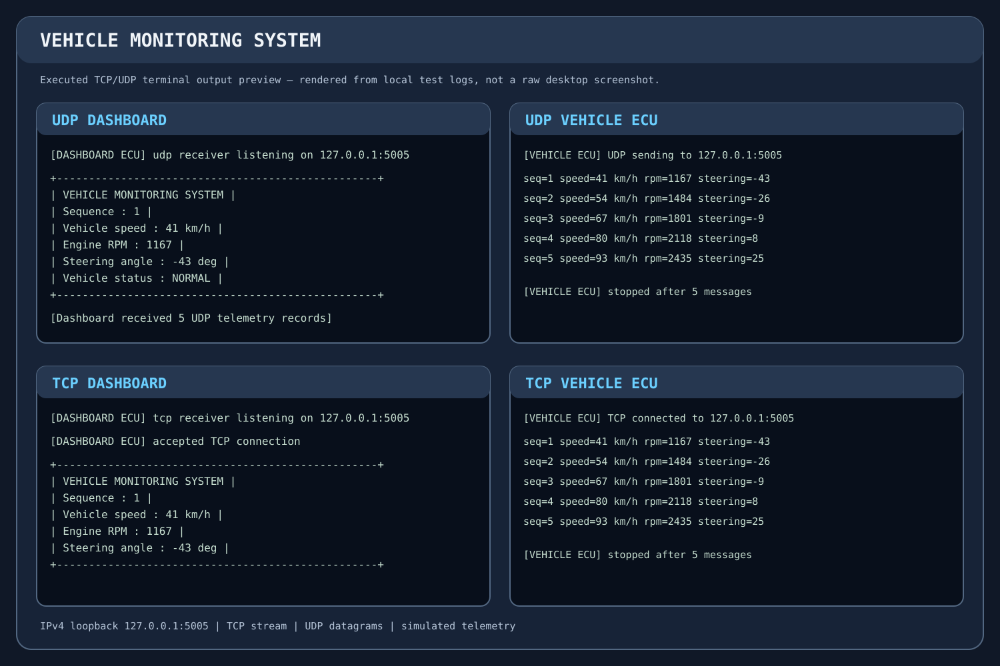

# Vehicle Monitoring System

A Linux C socket-programming project demonstrating vehicle-to-dashboard telemetry communication using **TCP and UDP**. This project is developed for the Automotive Communication Networks – Ethernet 2 practical assignment.

## Project objectives
- Generate repeatable vehicle telemetry in a simulated Vehicle ECU.
- Transmit telemetry using TCP and UDP over IPv4 sockets.
- Receive, validate, parse and display vehicle data in a Dashboard ECU.
- Compare connection-oriented TCP with connectionless UDP.
- Validate normal operation and selected communication failure cases.
- Provide experiment logs, technical reports and a Wireshark capture workflow.

## Vehicle parameters
- Vehicle speed (km/h)
- Engine RPM (rpm)
- Steering angle (degrees)
- Sequence number, status and millisecond timestamp

All vehicle values are **software-generated simulation data**, not live readings from a physical vehicle or sensors.

## Repository structure
```text
Vehicle-Monitoring-System/
├── README.md
├── Makefile
├── .gitignore
├── generate_reports.py
├── src/
│   ├── vehicle_ecu.c
│   ├── dashboard_ecu.c
│   └── Makefile
├── docs/
│   ├── Design_Document.pdf / .md
│   ├── TCP_UDP_Comparison.pdf / .md
│   └── Validation_Report.pdf / .md
├── logs/                 # Actual build and communication output
├── results/              # Validation scenario results
├── scripts/
│   └── run_experiments.sh
├── screenshots/          # Session-output preview and evidence guide
└── wireshark/            # Capture instructions
```

## Requirements
- Ubuntu or another Linux distribution
- GCC and Make
- Optional: Wireshark and tcpdump for packet-level analysis

Install build tools on Ubuntu:
```bash
sudo apt update
sudo apt install -y build-essential
```

## Build
From the repository root:
```bash
make clean
make
```
Executables are created in `build/`.

## Run UDP experiment
Terminal 1 – Dashboard ECU:
```bash
./build/dashboard_ecu --protocol udp --bind 127.0.0.1 --port 5005
```
Terminal 2 – Vehicle ECU:
```bash
./build/vehicle_ecu --protocol udp --host 127.0.0.1 --port 5005 --count 8
```

## Run TCP experiment
Start the TCP dashboard in Terminal 1:
```bash
./build/dashboard_ecu --protocol tcp --bind 127.0.0.1 --port 5005
```
Start the TCP vehicle sender in Terminal 2:
```bash
./build/vehicle_ecu --protocol tcp --host 127.0.0.1 --port 5005 --count 8
```

Use `--count 0` for continuous transmission. The default interval is one second; override it with `--interval-ms N`.

## Automated experiments
```bash
chmod +x scripts/run_experiments.sh
./scripts/run_experiments.sh
```
The runner compiles the applications, performs TCP and UDP communication tests, records logs, and attempts packet capture if tcpdump and capture permissions are available.

## Wireshark filters
| Purpose | Display filter |
|---|---|
| TCP port 5005 | `tcp.port == 5005` |
| UDP port 5005 | `udp.port == 5005` |
| TCP SYN | `tcp.flags.syn == 1` |
| TCP SYN-ACK | `tcp.flags.syn == 1 && tcp.flags.ack == 1` |
| TCP FIN | `tcp.flags.fin == 1` |

For this same-host demonstration, capture on the Linux loopback interface `lo`. A loopback capture shows local IP/TCP/UDP traffic; it is not a physical Ethernet-wire capture.

## Validation summary
The included logs and result files record successful compilation, successful local TCP and UDP telemetry exchange, expected UDP behavior when no receiver is listening, TCP connection refusal when no receiver is listening, and invalid IPv4 input rejection.

## Evidence note
The terminal-output preview in `screenshots/` is rendered from actual application logs and is explicitly labelled as a preview, not a raw desktop screenshot. Genuine PCAP files and Wireshark screenshots must be captured on a Linux host with packet-capture permission. They are not fabricated or claimed to be present in this repository. See `wireshark/README.md` and `screenshots/README.md`.

## Scope and limitations
This is an educational Linux application-layer socket demonstration over IPv4 loopback. It does not implement a physical Ethernet PHY, 100BASE-T1, SOME/IP, CAN, AUTOSAR, real sensor acquisition, vehicle hardware, or production automotive safety functions.


## Project output preview



## Technical documentation
- [Design Document](docs/Design_Document.md)
- [TCP vs UDP Comparison](docs/TCP_UDP_Comparison.md)
- [Validation Report](docs/Validation_Report.md)
- [Experiment runner instructions](scripts/README.md)
- [Wireshark capture instructions](wireshark/README.md)
